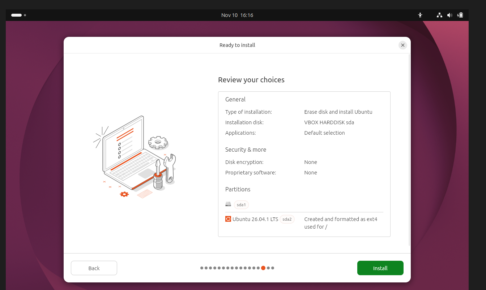
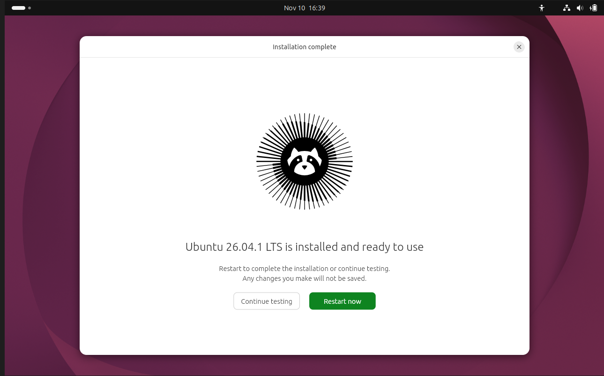
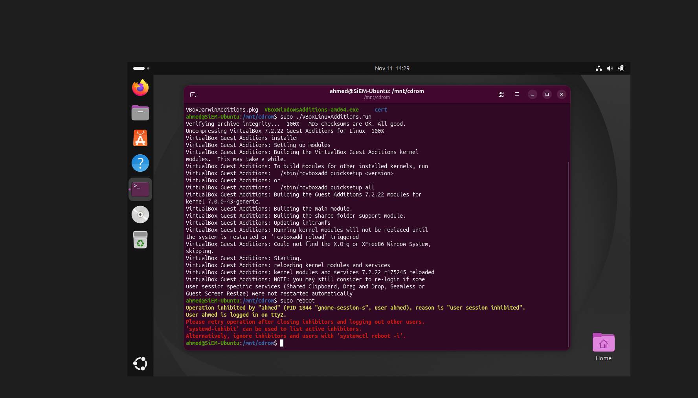
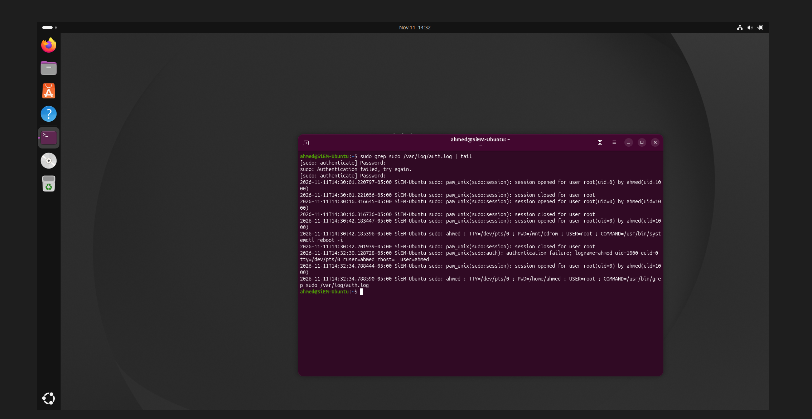
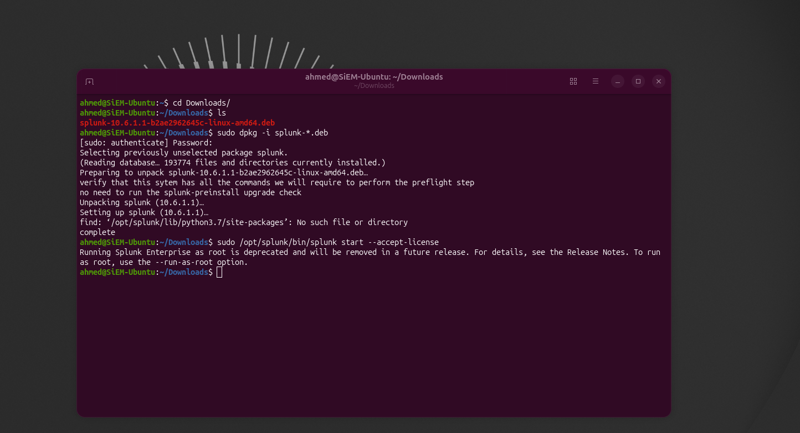
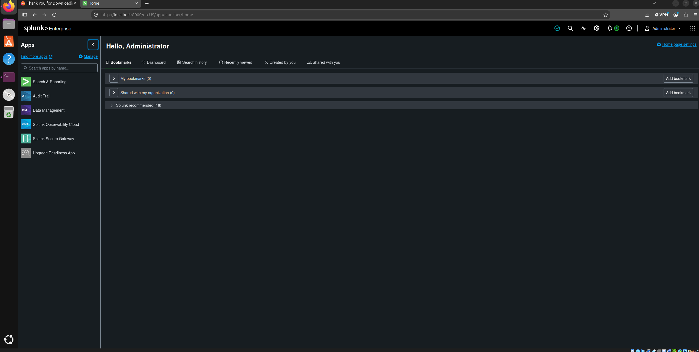
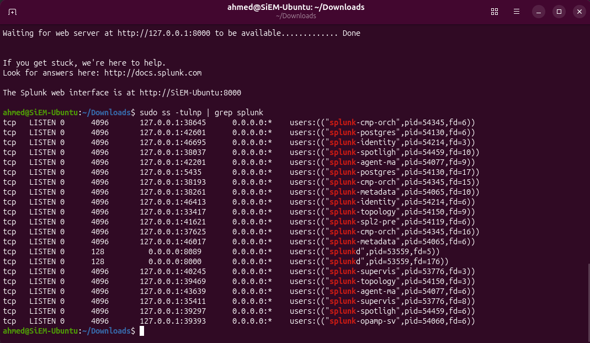
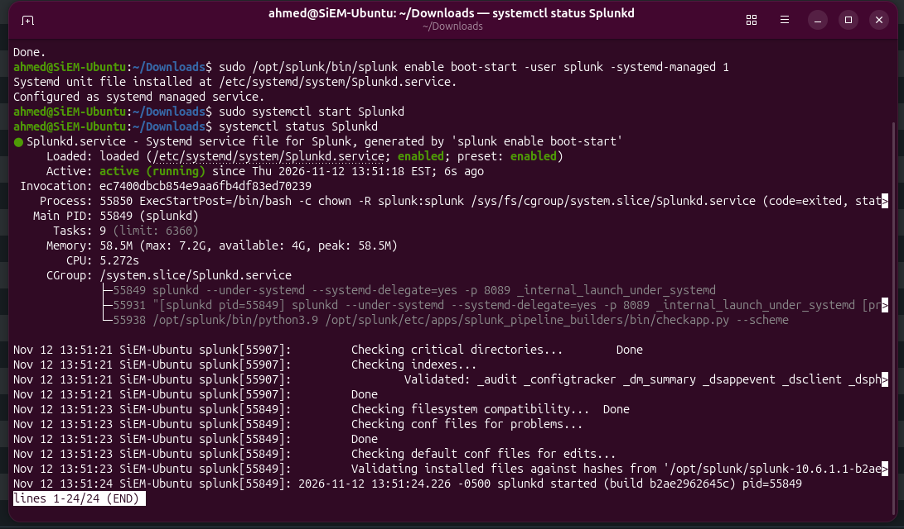
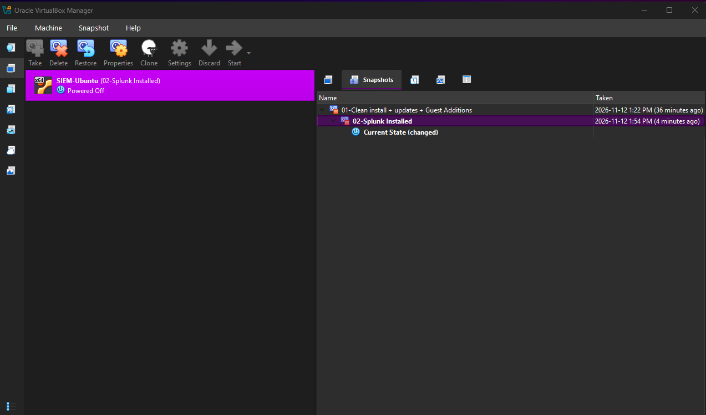

# Part 01: Building the SIEM Server

**Goal:** set up an Ubuntu virtual machine and install Splunk on it, so it's ready to receive logs from a Windows machine later.

**What I ended up with:** an Ubuntu VM running Splunk Enterprise as a background service, under its own low-privilege user, starting automatically at boot.

---

## 1. Creating the virtual machine

I installed **VirtualBox** on my laptop and created a VM for the SIEM server.

| Setting | Value | Why |
|---|---|---|
| OS | Ubuntu Desktop 26.04.1 LTS | LTS = long-term support. The desktop version lets me open Splunk in a browser inside the VM |
| RAM | 8 GB | Splunk needs plenty of memory |
| CPUs | 4 | Half my laptop's cores, so the host stays responsive |
| Disk | 80 GB (grows as needed) | Room for Ubuntu, Splunk, and weeks of logs |
| Disk encryption | None | Lab machine, no real data |
| Time zone | America/Toronto | Matches my laptop, so log timestamps line up when I correlate events across machines |





### What I learned: virtualization

- **Host** = my real laptop. **Guest** = the VM. **Hypervisor** = the software running the VM (VirtualBox).
- VirtualBox is a **Type 2** hypervisor (runs on top of Windows). Companies run servers on **Type 1** hypervisors that run directly on hardware.
- VirtualBox showed **"Execution engine: native API."** That means Windows' own hypervisor (used for security features like Memory integrity) is running underneath, so VirtualBox goes through it instead of using the CPU's virtualization directly. It's slower, but performance was fine on my laptop, so I **kept Memory integrity on** rather than lowering my host's security for speed.

---

## 2. Setting up Linux

### Patching

```bash
sudo apt update          # refresh the list of available updates
sudo apt upgrade -y      # install them
```

A fresh install is already out of date, and outdated software has known vulnerabilities (CVEs). This is patching.

### Guest Additions

Guest Additions are VirtualBox drivers that let the VM resize to fit the window and share copy-paste with my laptop. Installing them meant building drivers for my exact kernel:

```bash
sudo apt install -y build-essential bzip2 linux-headers-$(uname -r)
sudo mkdir -p /mnt/cdrom
sudo mount /dev/cdrom /mnt/cdrom
cd /mnt/cdrom
sudo ./VBoxLinuxAdditions.run
```



---

## 3. My first log investigation 🔍

After running several admin commands, I checked Linux's authentication log to see what had been recorded:

```bash
sudo grep sudo /var/log/auth.log | tail
```



Every `sudo` command was logged with **who** ran it, **from where**, **which folder** they were in, **which account** it ran as, and **the exact command**:

```
2026-11-11T14:30:42-05:00 SiEM-Ubuntu sudo: ahmed : TTY=/dev/pts/0 ; PWD=/mnt/cdrom ; USER=root ; COMMAND=/usr/bin/systemctl reboot -i
```

I had also **mistyped my password once**, and that was logged too:

```
2026-11-11T14:32:30-05:00 SiEM-Ubuntu sudo: pam_unix(sudo:auth): authentication failure; logname=ahmed uid=1000 euid=0 tty=/dev/pts/0 ruser=ahmed rhost= user=ahmed
```

**Why this matters for a SOC:** this is the Linux equivalent of Windows Event ID 4625 (failed logon). Many failures in a short time is what a brute-force detection looks for, and unexpected `sudo` use (`USER=root`) can point to privilege escalation. These are the logs a SIEM collects.

---

## 4. Installing Splunk

Splunk isn't in Ubuntu's software repositories, so I downloaded the `.deb` package from splunk.com and installed it with `dpkg`. It installs to `/opt/splunk`.

```bash
sudo dpkg -i splunk-*.deb
```

### Running Splunk as a low-privilege user

When I tried to start Splunk with `sudo`, it refused:

```
Running Splunk Enterprise as root is deprecated and will be removed in a future release.
```



Instead of forcing it with `--run-as-root`, I ran it the way a real deployment should: as its own `splunk` user. If Splunk were ever compromised, the attacker would get a limited account instead of full control of the server (**least privilege**).

```bash
id splunk                                   # the installer had already created this user (uid 1001)
sudo chown -R splunk:splunk /opt/splunk     # give it ownership of Splunk's files
sudo -u splunk /opt/splunk/bin/splunk start --accept-license
```



### Checking what's listening on the network

```bash
sudo ss -tulnp | grep splunk
```



| Address | Port | Process | Meaning |
|---|---|---|---|
| `0.0.0.0` | **8000** | splunkd | Splunk Web, reachable from the network |
| `0.0.0.0` | **8089** | splunkd | Management port, reachable from the network |
| `127.0.0.1` | many high ports | Splunk helper processes | Internal only, can't be reached from outside the VM |

**Key lesson:** `127.0.0.1` means only programs on the same machine can connect. `0.0.0.0` means anyone on the network can. During an investigation, an unfamiliar process listening on `0.0.0.0` could be a backdoor, and this one command reveals it.

### Making Splunk start at boot

```bash
sudo -u splunk /opt/splunk/bin/splunk stop
sudo /opt/splunk/bin/splunk enable boot-start -user splunk -systemd-managed 1
sudo systemctl start Splunkd
systemctl status Splunkd
```



This created a service file at `/etc/systemd/system/Splunkd.service`. Attackers use the same mechanism for **persistence** on Linux (a malicious service that runs at every boot, MITRE ATT&CK **T1543**), so this folder is worth checking during an investigation.

---

## 5. Snapshots

I took a VirtualBox snapshot after each milestone so I can roll back if something breaks:

- `01 - Clean install + updates + Guest Additions`
- `02 - Splunk installed`



---

## Problems I hit and how I fixed them

| Problem | Cause | Fix |
|---|---|---|
| `vmwgfx ... unsupported hypervisor` errors during boot | The graphics driver warning about VirtualBox's virtual graphics card | Harmless. Boot continued normally |
| `/media` was empty, Guest Additions not found | The virtual CD wasn't mounted | Mounted it manually with `sudo mount /dev/cdrom /mnt/cdrom` |
| `must be superuser to use mount` | Forgot `sudo` | Mounting is an admin action |
| `Operation inhibited` when rebooting | The desktop session blocks reboots from the terminal | Restarted from the desktop menu / `systemctl reboot -i` |
| `systemct1: command not found` | Typo: number `1` instead of letter `l` | `systemctl` |
| Splunk refused to run as root | Splunk 10 enforces least privilege | Ran it as the `splunk` user |

## What's next

Part 02: building the **Windows 11 victim VM** and putting both machines on a shared virtual network so they can talk to each other.
