# Part 02: Building the Windows Victim (and Switching Hypervisors)

**Goal:** build a Windows 11 VM to act as the "victim" endpoint, and get it on the same network as the Splunk server.

**What actually happened:** Windows 11 wouldn't boot in VirtualBox on my laptop. I investigated the cause, tried a fix, rolled it back, and moved the whole lab to VMware Workstation Pro instead. This part documents that, because the troubleshooting taught me as much as the build.

---

## 1. First attempt: VirtualBox

### Creating a lab network

I created a private NAT network in VirtualBox so the two VMs could talk to each other later. `VBoxManage` is VirtualBox's command-line tool, so it runs on the **host** (Windows), not inside a VM:

```
"C:\Program Files\Oracle\VirtualBox\VBoxManage.exe" natnetwork add --netname LabNet --network "10.0.2.0/24" --enable --dhcp on
```

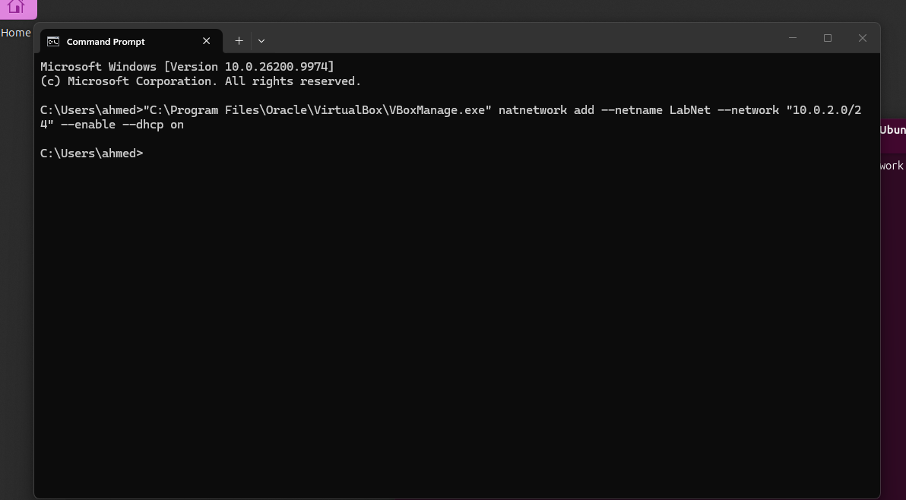

(I first ran this inside the Ubuntu VM by mistake and got `command not found`, which was a good reminder of the difference between host and guest.)

### The Windows VM

| Setting | Value |
|---|---|
| OS | Windows 11 Enterprise Evaluation (free 90-day trial) |
| RAM / CPUs / disk | 6 GB / 2 / 64 GB |
| EFI | On (Windows 11 requires it, along with TPM 2.0 and Secure Boot) |

### The problem: a black screen

The VM showed a black screen and never reached Windows Setup. The mouse jumped around the window, a sign the VM had captured the input but nothing was running to draw a pointer. Changing the graphics controller and video memory didn't help.


---

## 2. Troubleshooting

### The clue: "native API"

VirtualBox's status bar showed a green turtle icon and **"Execution engine: native API."** Ubuntu had worked in that mode (slowly), but Windows 11 never booted.

"Native API" means Windows' own hypervisor is already running underneath everything, so VirtualBox has to run *through* it instead of using the CPU's virtualization directly. On Windows 11 that hypervisor is used by **Virtualization-Based Security (VBS)**.

A Reddit thread with the exact same symptom (Win11 VM, black screen) pointed to the same cause: disable the Windows hypervisor and Device Guard.

### What I tried, step by step

**1. Memory integrity → Off** (Windows Security → Device security → Core isolation)

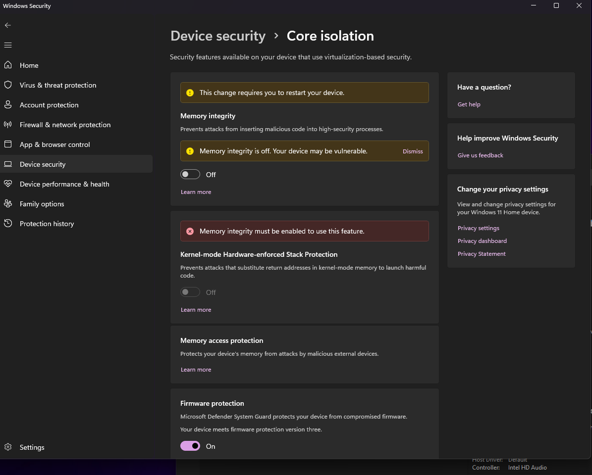

**2. Checked Windows features.** Virtual Machine Platform and Windows Hypervisor Platform were already off. Hyper-V doesn't exist on Windows 11 Home.

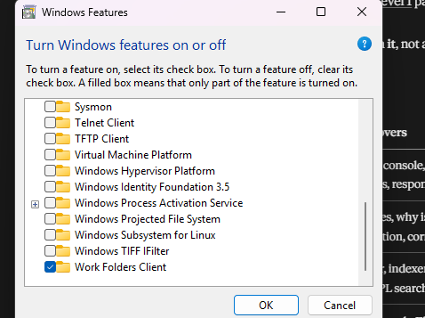

**3. Told Windows not to start its hypervisor at boot**

```
bcdedit /set hypervisorlaunchtype off
```

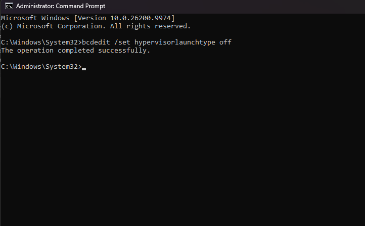

**4. Still "native API" after a restart, so I checked what was keeping VBS alive.** `msinfo32` showed VBS **Running**, with **Secure Launch** and **SMM Firmware Measurement** as active services. Those belong to the **Firmware protection** setting.


**5. Before touching firmware protection, I secured the BitLocker recovery key.** Device encryption was on, and changes to boot security can trigger a BitLocker recovery prompt. I pulled the key with `manage-bde -protectors -get C:` and saved a copy off the laptop.

**6. Firmware protection → Off.** The services disappeared, but VBS still showed Running.

**7. Checked the Device Guard registry key** (read-only first):

```
reg query "HKLM\SYSTEM\CurrentControlSet\Control\DeviceGuard"
```

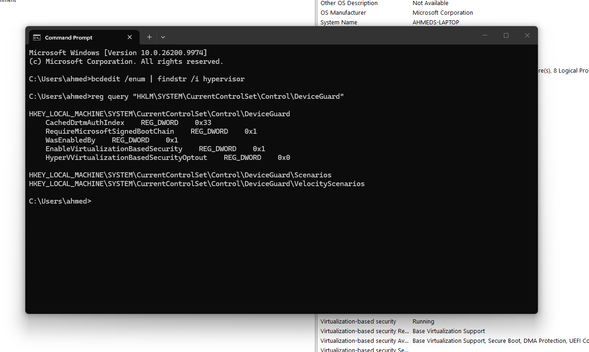

`EnableVirtualizationBasedSecurity` was `0x1`. I set it to `0` and restarted. VBS **still** showed Running, and Windows still wouldn't boot in VirtualBox.

### Why it didn't work

My laptop is a **Copilot+ PC** (Intel Core Ultra 9 288V). These machines are designed to keep VBS running for features like Windows Hello enhanced sign-in. Every switch I turned off, something else kept the hypervisor alive, and each step lowered more of the laptop's security.

### Rolling it back

I'd kept a list of every change, so I reverted all four:

| Change | Reverted with |
|---|---|
| Memory integrity off | Toggled back On |
| Firmware protection off | Toggled back On |
| `hypervisorlaunchtype off` | `bcdedit /set hypervisorlaunchtype auto` |
| `EnableVirtualizationBasedSecurity = 0` | `reg add ... /d 1 /f` |

Then I verified the rollback in `msinfo32`: VBS Running, with **Hypervisor enforced Code Integrity, Secure Launch, and SMM Firmware Measurement** all back.

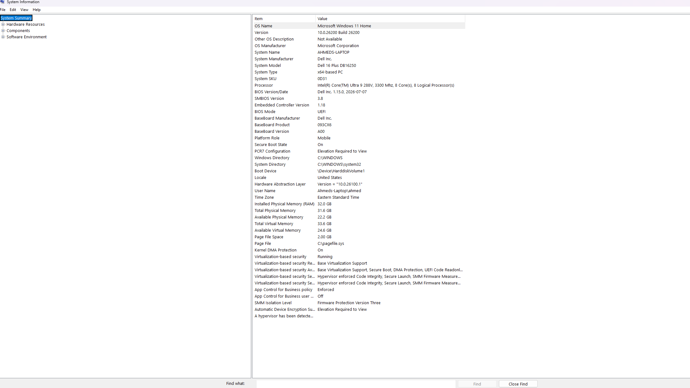

**Lesson:** when a fix requires weakening security more and more, it's usually the wrong fix. Track every change so you can undo it, and verify the undo.

---

## 3. Switching to VMware Workstation Pro

VMware Workstation Pro (free for personal use) can run **on top of** Windows' hypervisor using the Windows Hypervisor Platform, instead of competing with it. The installer detected VBS and confirmed it would run VMs that way, with no security features turned off.

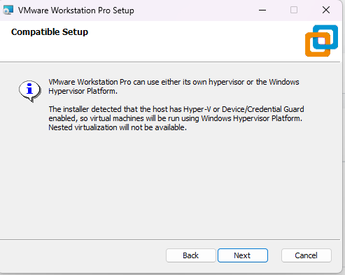

### Building the Windows VM again

Same specs: Windows 11 Enterprise Evaluation, 6 GB RAM, 2 CPUs, 64 GB disk, NAT networking. VMware asked to encrypt the files needed for the virtual TPM (a Windows 11 requirement).

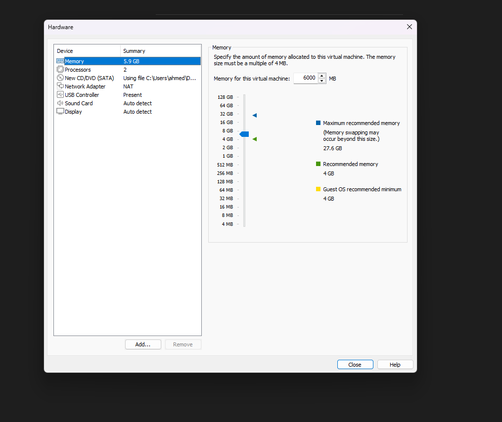

It reached the boot manager, which meant the VM was actually running this time. Selecting the virtual CD drive started Windows Setup.

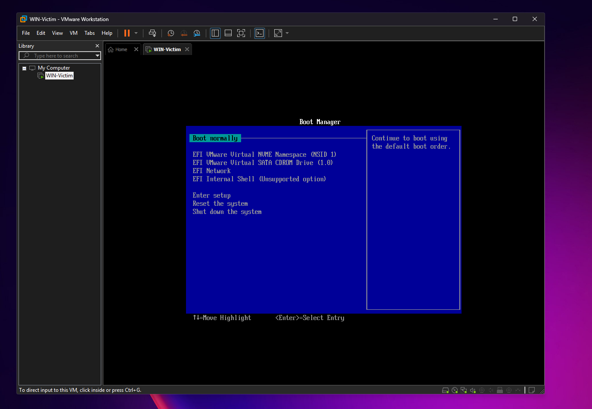
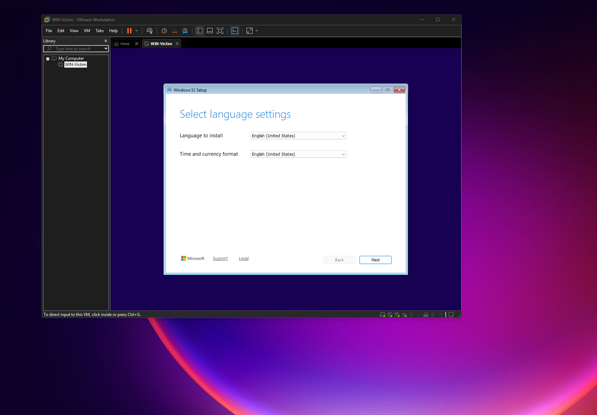

### A local account, not a Microsoft account

At the sign-in screen I used **Sign-in options → Domain join instead**, which creates a local account. Company PCs are usually joined to a domain (Active Directory) by IT later, so this mirrors that, and the lab VM isn't tied to a personal account. I also turned off every optional privacy and tracking setting.

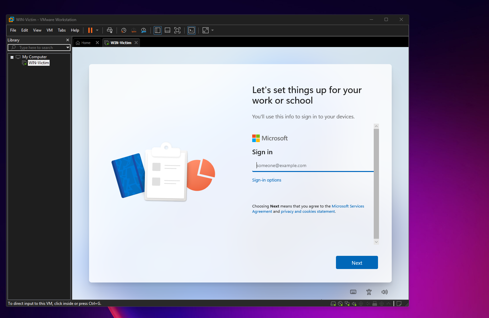
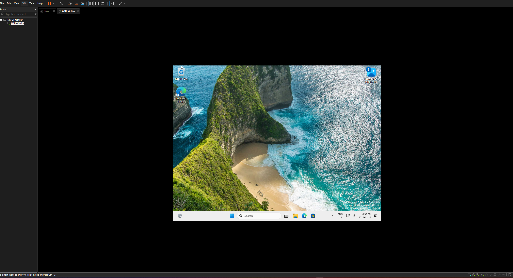

### VMware Tools

VMware Tools is VMware's version of VirtualBox Guest Additions: screen resizing and copy-paste. After installing it and restarting, the display filled the window.

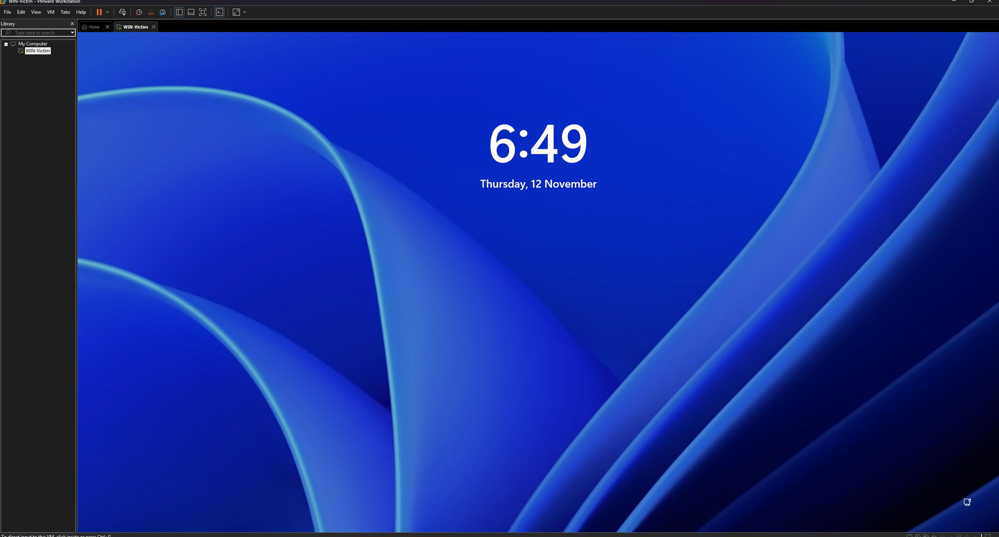

---

## 4. Moving the Splunk server into VMware

VMs in two different hypervisors can't share a private network, so the Ubuntu server had to move to VMware too.

1. Removed VirtualBox Guest Additions inside Ubuntu (`sudo /opt/VBoxGuestAdditions-*/uninstall.sh`), then shut it down
2. Exported it from VirtualBox as an **`.ova`** file (a single portable package containing the whole VM), stripping the network card's MAC address so VMware would assign a fresh one
3. Saved the export outside OneDrive, so the cloud sync wouldn't try to upload a 10 GB file
4. Imported it into VMware

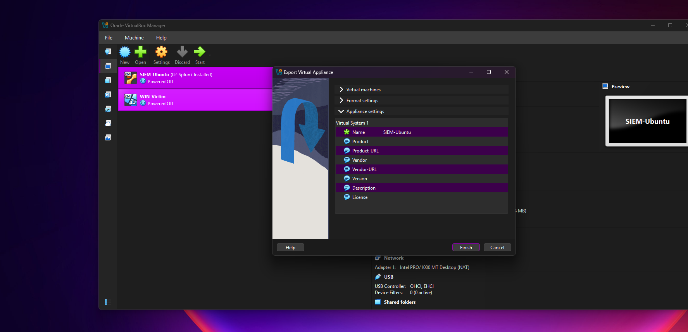

VMware flagged the file as not passing its OVF checks, which is common with VirtualBox exports, since the two describe virtual hardware slightly differently. Retrying with relaxed checks worked.

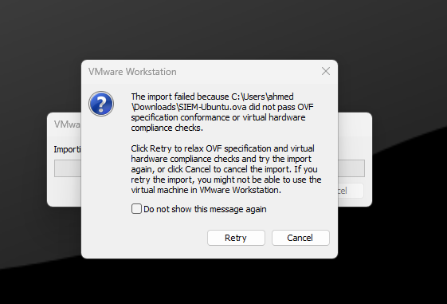
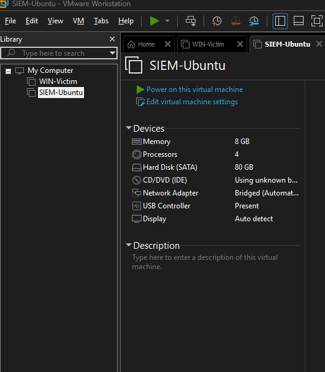

The import kept the 8 GB RAM, 4 CPUs, and 80 GB disk. Two settings needed fixing before the first boot:

- **Network adapter:** came in as **Bridged** (directly on my home network). I changed it to **NAT** so both VMs share VMware's private network
- **CD/DVD:** still pointed at the old Guest Additions disc, so I disconnected it

### First boot in VMware

Ubuntu booted straight to the desktop. I installed VMware's Linux guest tools, which replace VirtualBox Guest Additions and come straight from Ubuntu's repositories:

```bash
sudo apt update
sudo apt install -y open-vm-tools-desktop
sudo reboot
```

### Verifying Splunk survived the move

Everything lives on the virtual disk, so Splunk, its service file, and its data all came across:

```bash
systemctl status Splunkd
```

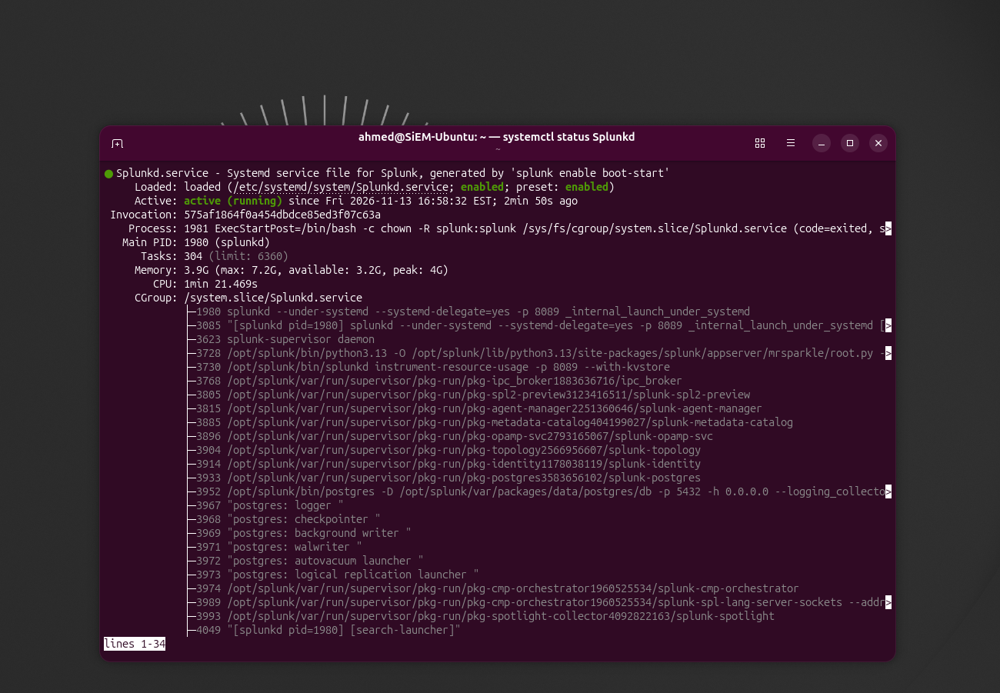

Still `enabled` at boot and `active (running)`, under the same systemd service from Part 01. Splunk Web loaded at `localhost:8000`, and the display resized with the window, confirming `open-vm-tools` was working.

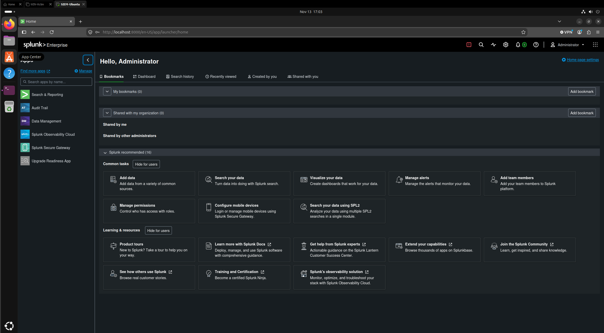

**Something to follow up on:** the service status shows Splunk's bundled Postgres database started with `-h 0.0.0.0`, which means it's set to listen on every network interface, not just localhost. Next part I'll check with `ss` whether port 5432 is actually reachable from the network, the same `127.0.0.1` vs `0.0.0.0` check from Part 01.

I took a fresh snapshot (`01 - Migrated to VMware, Splunk running`), since VirtualBox snapshots don't carry over in an export.

---

## Problems I hit and how I fixed them

| Problem | Cause | Fix |
|---|---|---|
| `VBoxManage.exe: command not found` | Ran a host command inside the Ubuntu guest | Ran it in Windows Command Prompt |
| Windows 11 black screen in VirtualBox | VBS keeps Windows' hypervisor running, forcing VirtualBox into "native API" mode | Switched to VMware, which runs on top of the Windows hypervisor |
| VBS wouldn't turn off | Copilot+ PCs keep VBS running for built-in features | Rolled back all changes and kept the laptop's security intact |
| Leftover folder blocked the VM name | Removing a VM in VirtualBox kept its files | Deleted the leftover folder (next time: "Delete all files") |
| Missed "Press any key to boot from CD" | The prompt only waits a few seconds | Selected the CD drive from the boot manager |
| OVF import check failed | VirtualBox and VMware describe hardware differently | Retry with relaxed checks |
| Imported VM on Bridged networking | Default from the import | Changed to NAT |
| CD drive pointed at a missing disc | Leftover Guest Additions disc from VirtualBox | Disconnected it before first boot |

## Where the lab stands

```
VMware Workstation Pro
 ├─ SIEM-Ubuntu  (Splunk running)   NAT
 └─ WIN-Victim   (Windows 11)       NAT
```

## What's next

Both VMs are on the same VMware NAT network. Next: find each machine's IP address, work through how NAT and subnets fit together, and get the two VMs talking to each other.
