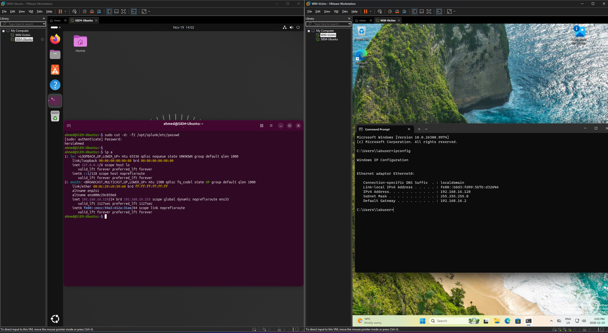
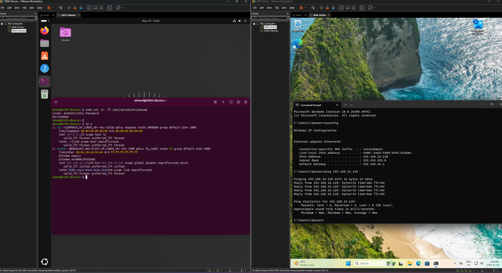
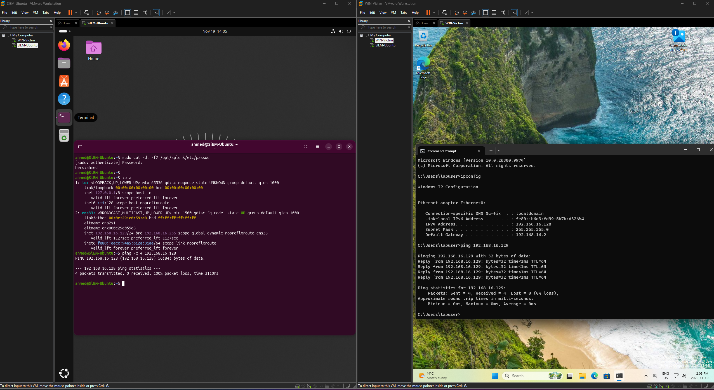
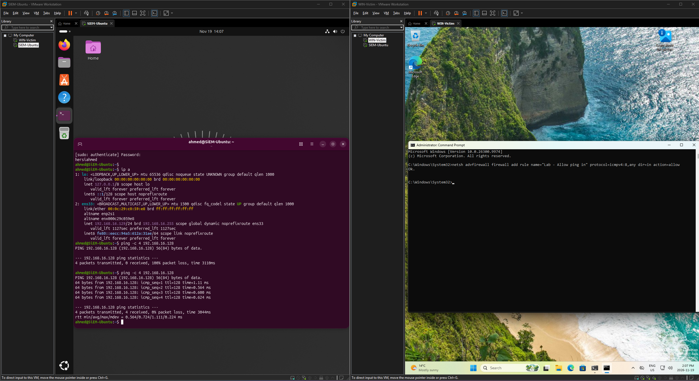

# Part 03: Connecting the Lab Network

**Goal:** confirm the Splunk server and the Windows victim can reach each other, since Windows will soon send its logs to Splunk over this network.

**What I ended up with:** both VMs on VMware's NAT network, reachable in both directions, after finding and fixing a Windows Firewall block.

---

## 1. Concepts I needed first

| Term | Stands for | What it means |
|---|---|---|
| **IP address** | Internet Protocol address | A device's address on a network, like a phone number |
| **Private IP** | | Only works inside one network. Starts with `10.`, `172.16–31.` or `192.168.` |
| **LAN** | Local Area Network | Devices in one place that can talk to each other directly |
| **NAT** | Network Address Translation | Lets many private devices share one connection out, while blocking unsolicited traffic in |
| **Subnet / CIDR** | Classless Inter-Domain Routing | The `/24` in `192.168.16.129/24`: the first three numbers identify the network, the last identifies the device |
| **DHCP** | Dynamic Host Configuration Protocol | Hands out IP addresses automatically |
| **Gateway** | | The "way out" of the network (VMware's NAT device) |
| **ICMP** | Internet Control Message Protocol | The protocol `ping` uses |
| **TTL** | Time To Live | A hop counter on packets. Its starting value hints at the OS: 64 for Linux, 128 for Windows |

**Why private vs public matters for a SOC:** in a log, `192.168.16.128` means an internal device, while an address like `51.102.10.19` is somewhere on the internet. It's one of the fastest ways to make sense of a connection.

---

## 2. Finding each machine's address

```bash
ip a          # Ubuntu
```
```
ipconfig      # Windows
```



| | Ubuntu (Splunk) | Windows (victim) |
|---|---|---|
| Interface | `ens33` | `Ethernet0` |
| IP address | `192.168.16.129/24` | `192.168.16.128` |
| Subnet mask | `/24` | `255.255.255.0` (the same thing written differently) |
| Gateway | | `192.168.16.2` (VMware NAT) |

Both start with `192.168.16`, so they're on the same subnet and can talk directly.

Other details I could now read:

- **`lo` / `127.0.0.1`** is the loopback interface, the machine talking to itself. It's the `localhost` I use to open Splunk
- **`dynamic`** and **`valid_lft 1127sec`** mean the address came from DHCP and is leased for a limited time
- **`brd 192.168.16.255`** is the broadcast address, used to reach every device on the subnet at once
- The interface is now `ens33`, VMware's naming, since the VM moved from VirtualBox in Part 02

**Note for later:** because the addresses come from DHCP, they can change. Once Windows is sending logs to Splunk, I'll want the Splunk server on a fixed address.

---

## 3. Testing the connection

### Windows → Ubuntu: works

```
ping 192.168.16.129
```



4 sent, 4 received, 0% loss, `time<1ms` (the traffic never leaves my laptop), and `TTL=64`, which points to Linux on the other end.

### Ubuntu → Windows: blocked

```bash
ping -c 4 192.168.16.128
```



4 sent, 0 received, 100% packet loss.

**Why:** the network was fine, since one direction already worked. **Windows Defender Firewall blocks incoming ICMP echo requests by default.** Ubuntu allows them, so the problem was only in one direction.

### The fix: a firewall rule

From an administrator Command Prompt on Windows:

```
netsh advfirewall firewall add rule name="Lab - Allow ping in" protocol=icmpv4:8,any dir=in action=allow
```

| Part | Meaning |
|---|---|
| `protocol=icmpv4:8,any` | ICMP type 8 = echo request (a ping) |
| `dir=in` | Applies to incoming traffic only |
| `action=allow` | Let it through |
| `name=...` | A label, so the rule is easy to find or remove later |

This only allows pings. It doesn't open anything else on the Windows VM.

### Retest: works both ways



4 sent, 4 received, 0% loss, now with `ttl=128`, the Windows default.

---

## What I took from this

- **Test both directions.** A connection working one way says nothing about the other
- **The receiving side decides.** Traffic only gets in if the destination's firewall allows it. This matters next, when Windows connects to Splunk's receiving port (9997) on Ubuntu
- **Ping can fingerprint an OS.** TTL 64 vs 128 told me Linux vs Windows with no other information. Attackers use the same trick during reconnaissance (MITRE ATT&CK: Active Scanning)

## Problems I hit and how I fixed them

| Problem | Cause | Fix |
|---|---|---|
| Ping from Ubuntu to Windows got 100% loss | Windows Firewall blocks inbound ICMP by default | Added a firewall rule allowing ICMP echo requests in |

## What's next

Install Sysmon on Windows, set up the Splunk Universal Forwarder, open Splunk's receiving port, and see the first Windows logs arrive in Splunk.
