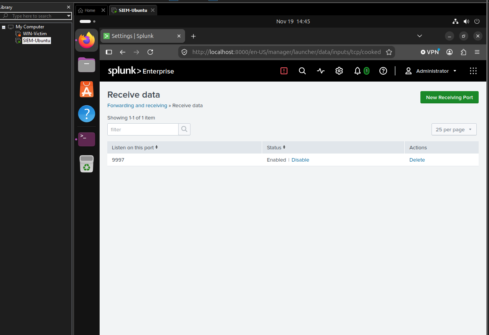
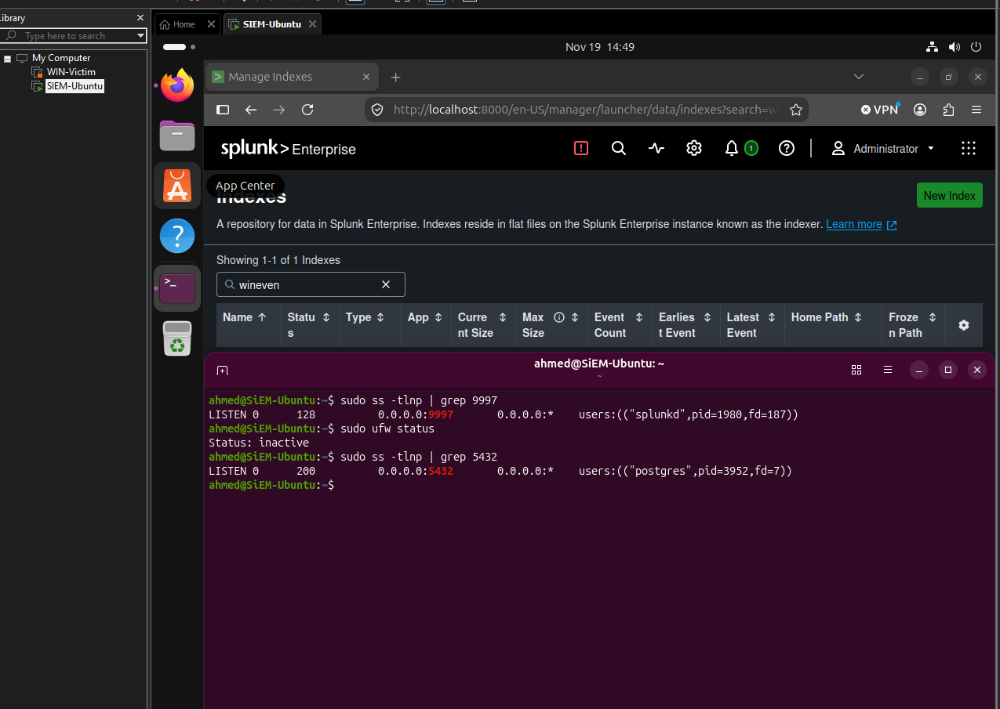
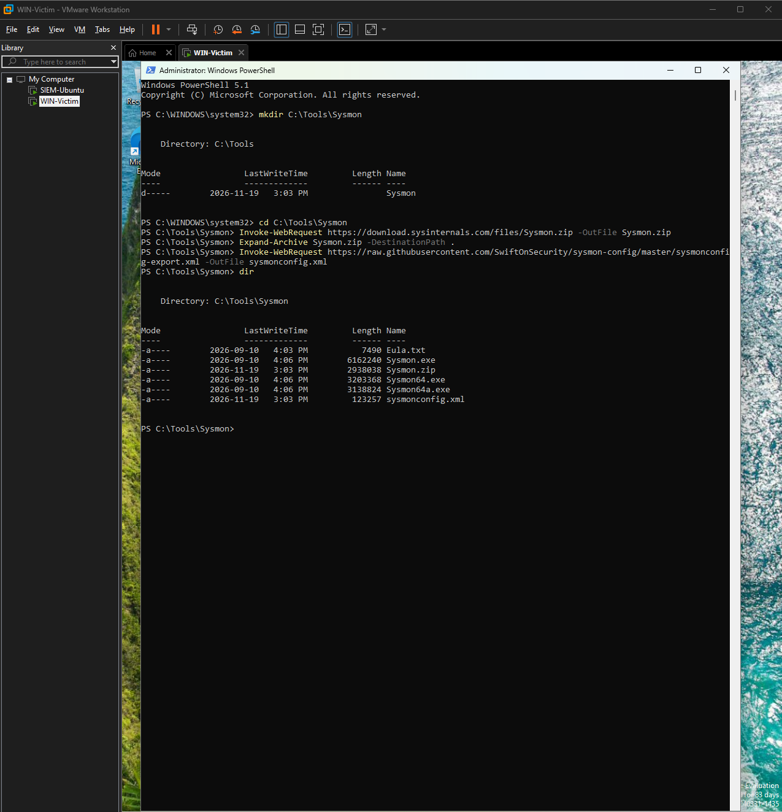
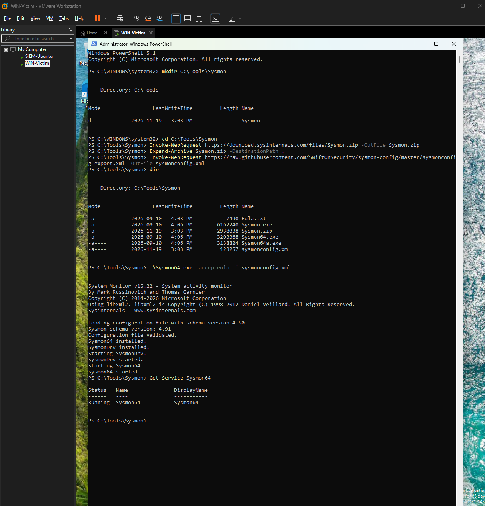
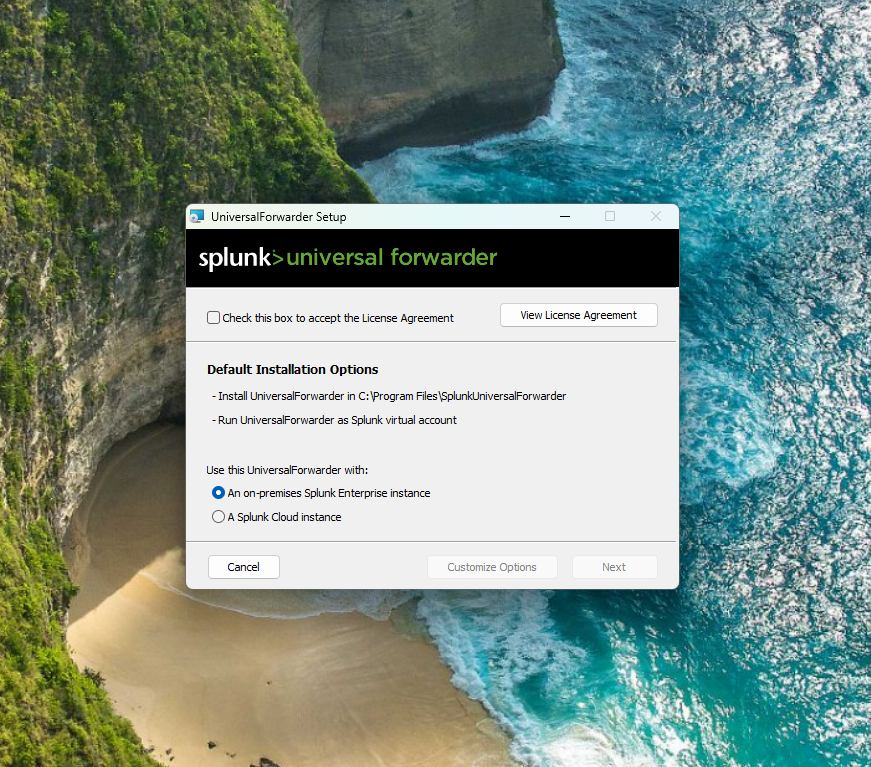
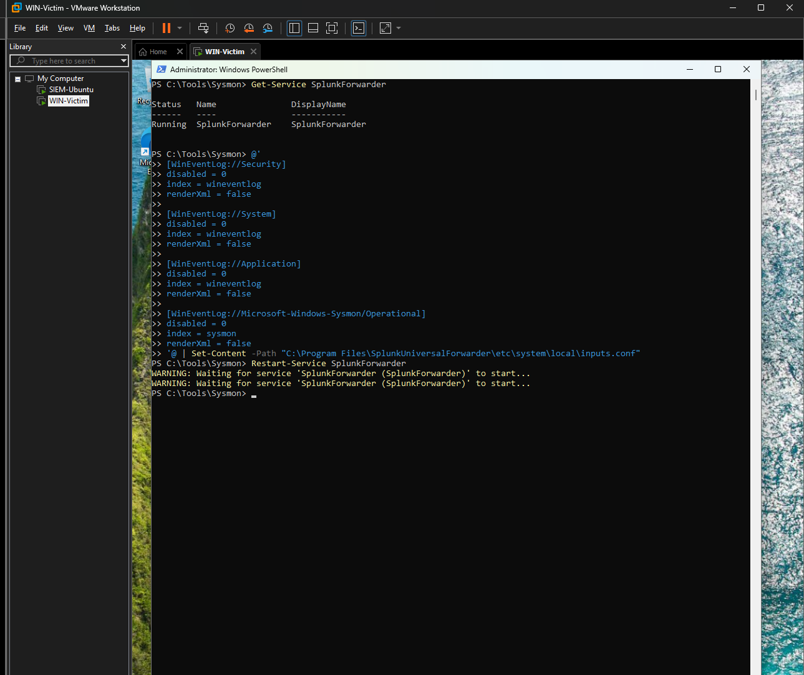
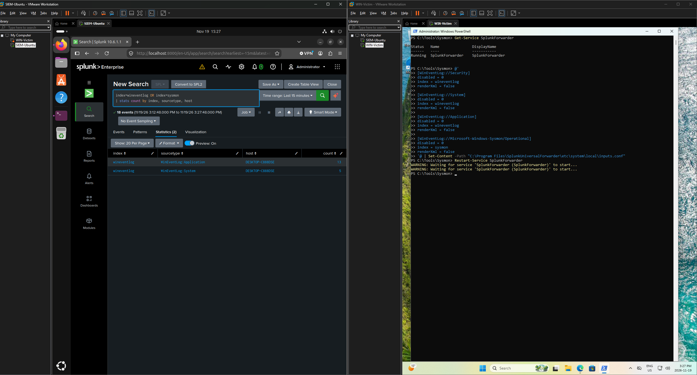
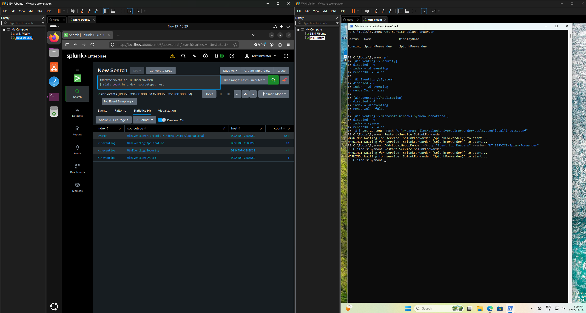
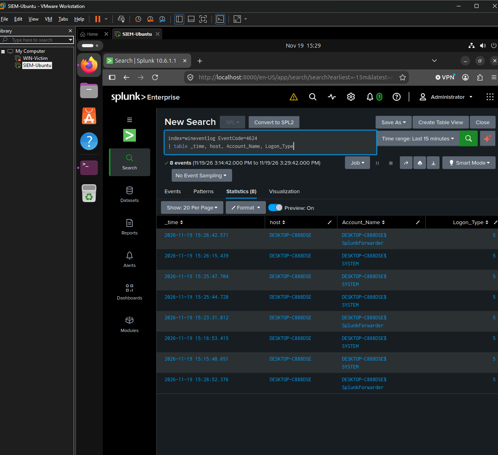
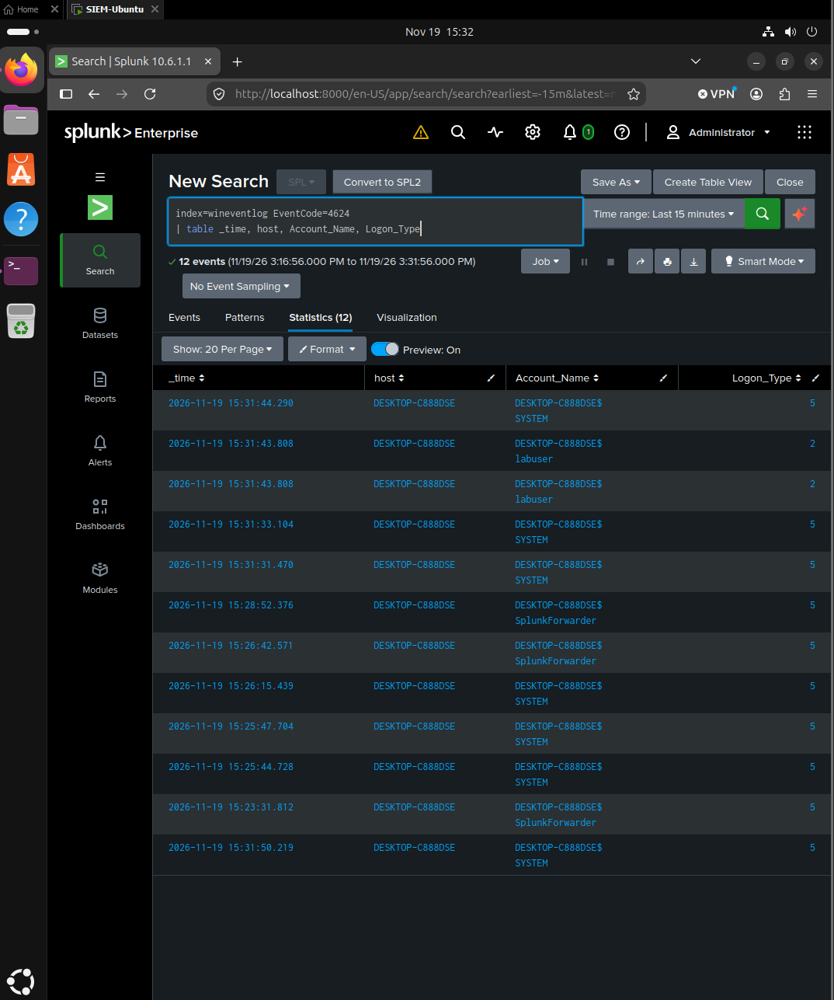

# Part 04: Forwarding Windows Logs to Splunk

**Goal:** get the Windows victim sending its security logs to Splunk, so the lab works as an actual SIEM.

**What I ended up with:** Windows Security, System, and Application logs plus detailed Sysmon telemetry, all arriving in Splunk in real time, and my first log searches against my own machine.

```
WIN-VICTIM (192.168.16.128)                        SIEM-Ubuntu (192.168.16.129)
┌───────────────────────────┐                      ┌────────────────────────┐
│ Windows Event Logs        │                      │                        │
│ Sysmon                    │   TCP port 9997      │  Splunk Enterprise     │
│   └─ Universal Forwarder ─┼─────────────────────►│  indexes: wineventlog  │
│                           │                      │           sysmon       │
└───────────────────────────┘                      └────────────────────────┘
```

---

## 1. Concepts

| Term | Meaning |
|---|---|
| **Windows Event Log channels** | Separate logbooks: **Security** (logons 4624/4625, process creation 4688), **System** (services, e.g. 7045), **Application** |
| **Sysmon** (System Monitor) | A free Microsoft Sysinternals tool that logs far more detail than default Windows logging: process creation with full command lines (Event 1), network connections (3), file creation (11), registry changes (13), DNS queries (22) |
| **Sysmon config** | Filters out normal background noise. I used SwiftOnSecurity's widely used community config |
| **Universal Forwarder (UF)** | Splunk's lightweight agent that reads logs on an endpoint and ships them to the indexer |
| **Port 9997 / TCP** | Splunk's default receiving port. TCP (Transmission Control Protocol) confirms delivery, so logs aren't silently dropped |
| **Index** | A storage bucket in Splunk. I used separate ones for Windows event logs and Sysmon |
| **Sourcetype** | A label for the log format, so Splunk knows how to parse it |

---

## 2. Preparing Splunk to receive

In Splunk Web: **Settings → Forwarding and receiving → Configure receiving → port 9997**, then **Settings → Indexes** to create `wineventlog` and `sysmon`. (Index names must be lowercase. My first attempt had a capital letter.)



Then I checked from the terminal:

```bash
sudo ss -tlnp | grep 9997    # is Splunk listening?
sudo ufw status              # is Ubuntu's firewall in the way?
sudo ss -tlnp | grep 5432    # follow-up from Part 02
```



| Check | Result | Meaning |
|---|---|---|
| Port 9997 | `0.0.0.0:9997` owned by `splunkd` | Accepting connections from other machines, as intended |
| Firewall | `inactive` | Nothing blocking the forwarder |
| Port 5432 | `0.0.0.0:5432` owned by `postgres` | ⚠️ **Finding:** Splunk's internal database is reachable from the network, though nothing outside the server needs it |

**About the Postgres finding:** in this lab it's only reachable by my own VMs behind VMware NAT, so the risk is low. On a production server it's the kind of unnecessary exposure a security review flags. I'm noting it here to restrict it later.

---

## 3. Installing Sysmon

From an administrator PowerShell on Windows:

```powershell
mkdir C:\Tools\Sysmon
cd C:\Tools\Sysmon
Invoke-WebRequest https://download.sysinternals.com/files/Sysmon.zip -OutFile Sysmon.zip
Expand-Archive Sysmon.zip -DestinationPath .
Invoke-WebRequest https://raw.githubusercontent.com/SwiftOnSecurity/sysmon-config/master/sysmonconfig-export.xml -OutFile sysmonconfig.xml
```



The zip contains three builds: `Sysmon.exe` (32-bit), `Sysmon64.exe` (64-bit x86, what I used), and `Sysmon64a.exe` (ARM).

```powershell
.\Sysmon64.exe -accepteula -i sysmonconfig.xml
Get-Service Sysmon64
```



The install loads **SysmonDrv**, a driver that sees activity at a low level, plus the **Sysmon64** service that writes it to the event log.

**Verifying it was recording before forwarding anything:**

```powershell
Get-WinEvent -LogName "Microsoft-Windows-Sysmon/Operational" -MaxEvents 10 | Select-Object TimeCreated, Id
```


Within seconds it had logged process creation (1), file creation (11), a DNS query (22), and one **Event 8, CreateRemoteThread**: one process starting code inside another. That's almost certainly benign Windows activity here, but it's also how **process injection** works, so it's an event analysts watch closely.

---

## 4. Installing the Universal Forwarder

I downloaded the 64-bit Windows `.msi` (UF 10.6.2.5, a newer patch than my 10.6.1.1 indexer, which is compatible).



| Installer screen | My choice | Why |
|---|---|---|
| Deployment type | On-premises Splunk Enterprise | My Splunk runs on my own VM |
| Service account | Default virtual account | The forwarder runs with limited privileges (least privilege) |
| Admin credentials | My own, saved in a password manager | Needed for forwarder CLI commands |
| Deployment server | Blank | Used to manage many forwarders centrally. I only have one |
| Receiving indexer | `192.168.16.129 : 9997` | Ubuntu's IP and the port Splunk is listening on |

### Telling it what to collect

The installer only configures *where* to send. *What* to send goes in `inputs.conf`:

```ini
[WinEventLog://Security]
disabled = 0
index = wineventlog
renderXml = false

[WinEventLog://System]
disabled = 0
index = wineventlog
renderXml = false

[WinEventLog://Application]
disabled = 0
index = wineventlog
renderXml = false

[WinEventLog://Microsoft-Windows-Sysmon/Operational]
disabled = 0
index = sysmon
renderXml = false
```

Saved to `C:\Program Files\SplunkUniversalForwarder\etc\system\local\inputs.conf`, followed by `Restart-Service SplunkForwarder`.



---

## 5. Troubleshooting: half the logs were missing

```spl
index=wineventlog OR index=sysmon
| stats count by index, sourcetype, host
```



Application and System logs arrived, but **Security and Sysmon didn't**.

**Diagnosis:** the forwarder clearly worked (some logs got through), so the problem was specific to those two sources. Both are **protected channels** that Windows only lets certain accounts read. The forwarder's least-privilege virtual account (`NT SERVICE\SplunkForwarder`) didn't have read access.

**Fix:** rather than running the forwarder as SYSTEM or an administrator, I granted read-only access through Windows' built-in **Event Log Readers** group:

```powershell
Add-LocalGroupMember -Group "Event Log Readers" -Member "NT SERVICE\SplunkForwarder"
Restart-Service SplunkForwarder
```



All four sources arrived. Sysmon produced **651 events in about 15 minutes** even with a filtering config, a good reminder of why tuning and targeted searches matter.

---

## 6. First investigation: who's logging on?

```spl
index=wineventlog EventCode=4624
| table _time, host, Account_Name, Logon_Type
```



Every result was **Logon Type 5 (service)**. Each event shows two accounts: `DESKTOP-C888DSE$` (the computer's own account, which handled the logon) and the account that actually logged on (`SYSTEM` or `SplunkForwarder`).

The `SplunkForwarder` logons at 15:23, 15:26, and 15:28 **matched the times I restarted the forwarder**, the first time I tied a log entry back to something I'd actually done.

### Testing an assumption

I locked the Windows VM and signed back in, expecting an unlock to log as **type 7**.



It logged as **type 2 (interactive)**. On Windows 11, unlocking typically goes through a fresh interactive sign-in. The account also produced **two linked logon events at the same instant**, because it's an administrator: with UAC (User Account Control), an admin sign-in creates both a standard and an elevated session.

| Logon type | Meaning |
|---|---|
| 2 | Interactive (at the keyboard) |
| 3 | Network (e.g. accessing a share) |
| 5 | Service |
| 7 | Unlock (older Windows) |
| 10 | Remote Desktop |

**Lesson:** check what your own environment actually logs rather than relying on what it "should" log.

---

## Problems I hit and how I fixed them

| Problem | Cause | Fix |
|---|---|---|
| Index created with a capital letter | Splunk index names must be lowercase | Recreated as `wineventlog` |
| Security and Sysmon logs missing | The forwarder's virtual account couldn't read protected log channels | Added `NT SERVICE\SplunkForwarder` to Event Log Readers |
| PowerShell `WARNING: Waiting for service...` | Normal output while a service restarts | No fix needed |

## Open items

- Restrict Splunk's Postgres (port 5432) to localhost
- Rename the Windows host from `DESKTOP-C888DSE` to something readable
- Give the Splunk server a fixed IP so the forwarder's destination can't change

## What's next

Simulate attacker activity on the Windows VM (failed logons, discovery commands, scheduled-task persistence), then build Splunk detections for each, mapped to MITRE ATT&CK.
