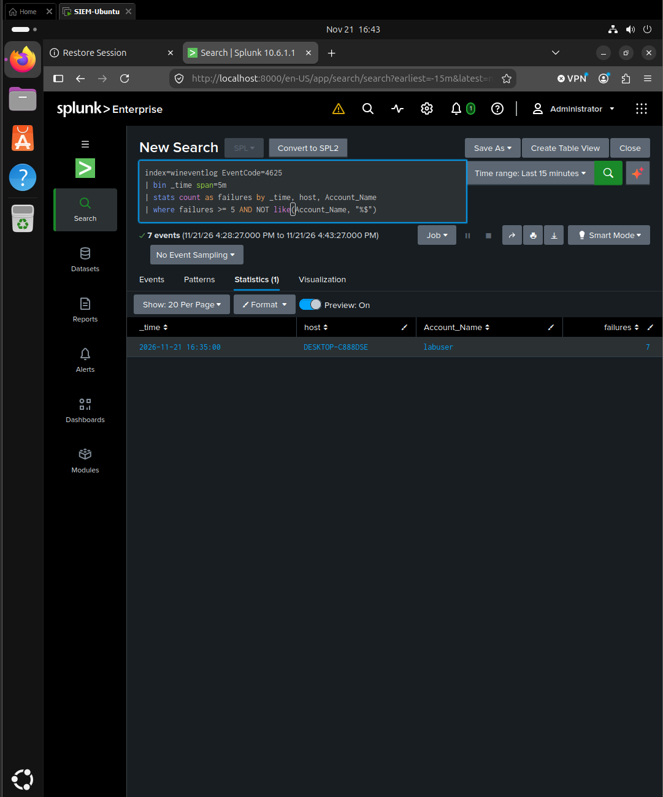
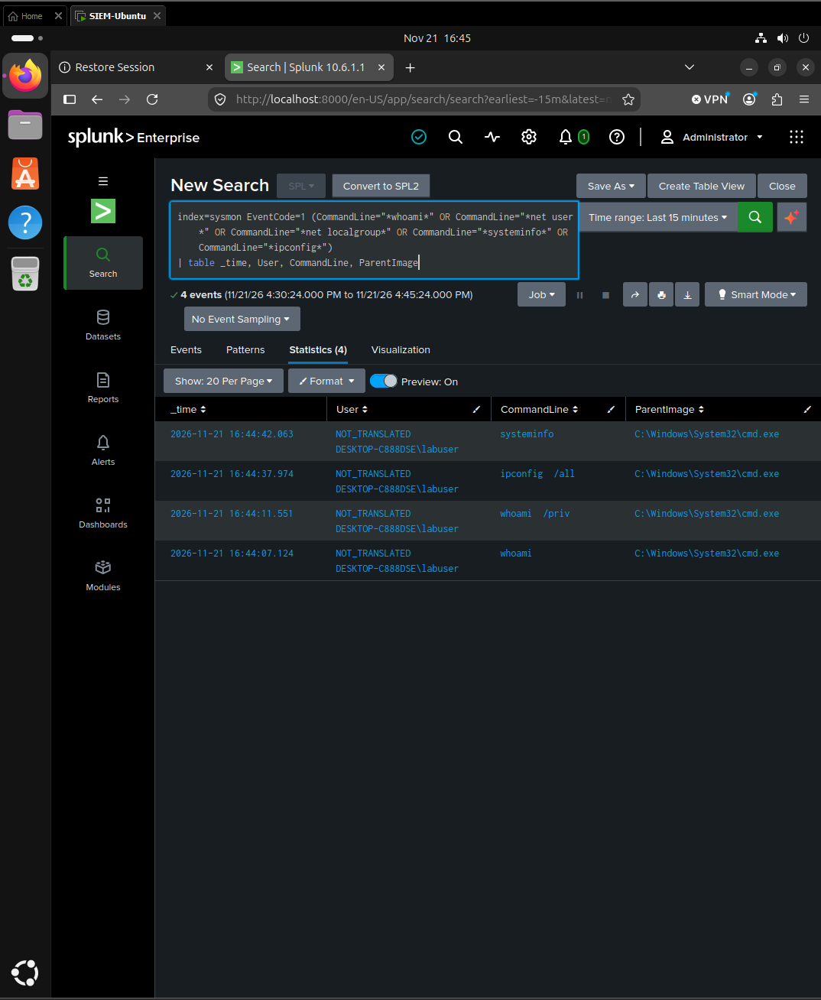
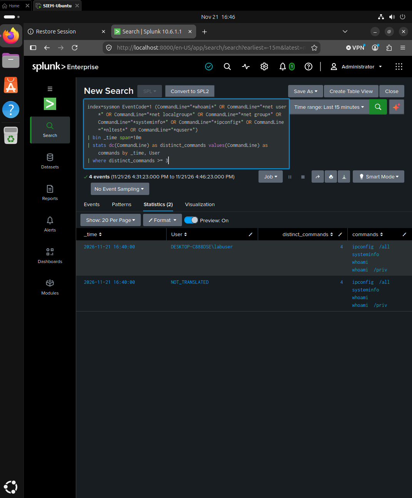
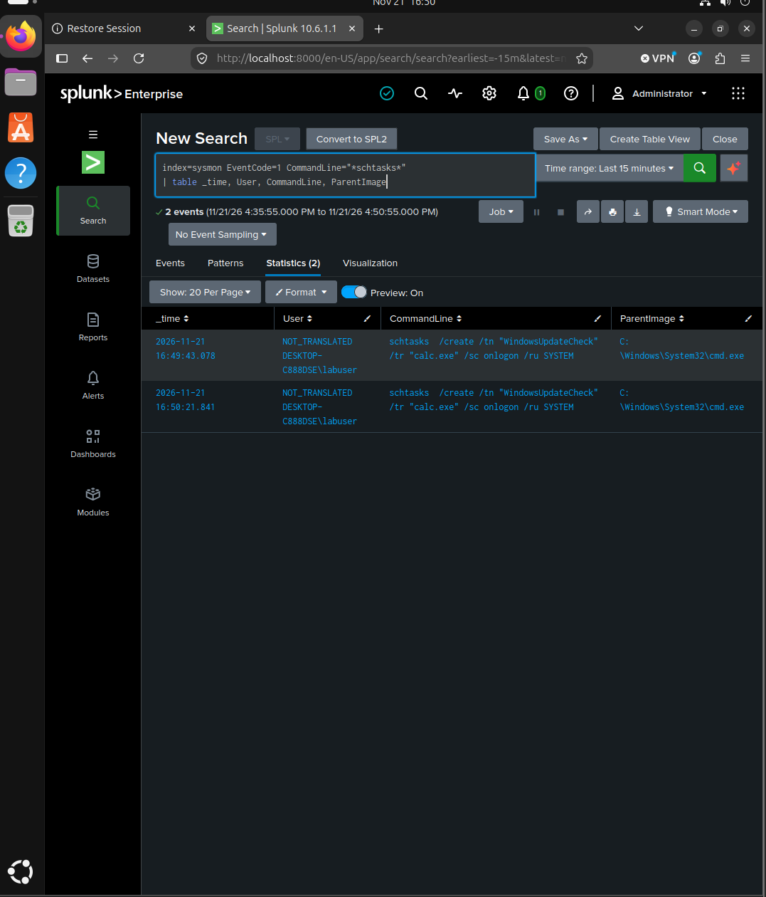
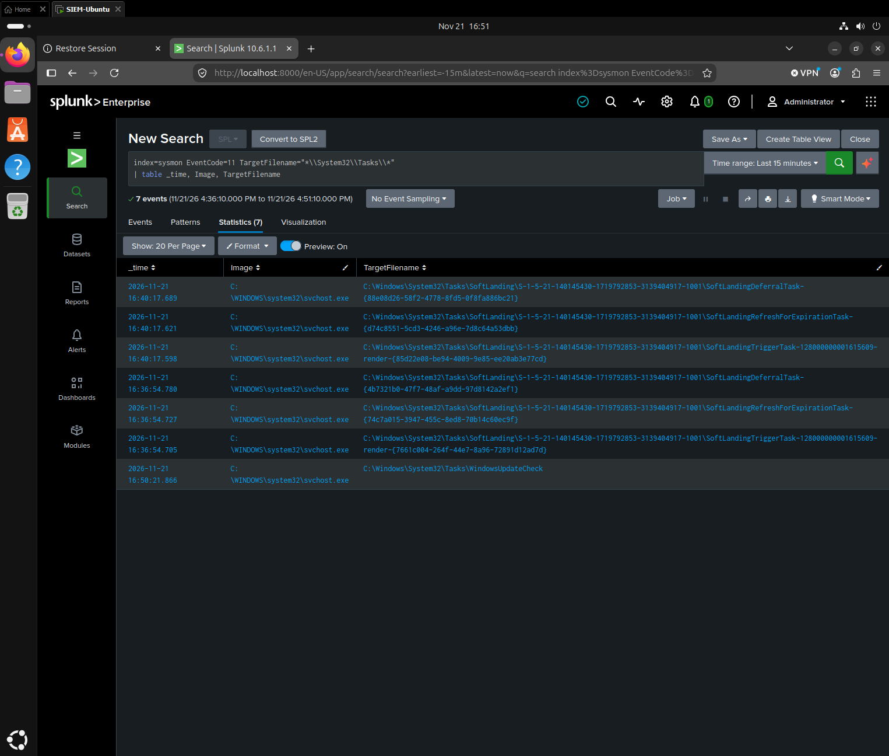

# Part 05: Simulated Attacks and Detections

**Goal:** generate realistic attacker activity on the Windows VM, hunt it in Splunk, and build detections for each, mapped to MITRE ATT&CK.

**Approach for each attack:**
1. Run the activity on the Windows VM (red team)
2. Find it in Splunk (hunt)
3. Write a detection search that would catch it automatically (blue team)
4. Map it to MITRE ATT&CK

All activity was performed on my own lab VM to produce benign log events for detection practice.

---

## Attack 1: Brute force — T1110 (Credential Access)

### Simulate
I generated failed logons by entering the wrong password several times at the Windows lock screen. Each failure writes **Event 4625** to the Security log. Windows' own logon throttling ("Invalid credentials, delaying next attempt") kicked in, which is itself an anti-brute-force control.

### Hunt
```spl
index=wineventlog EventCode=4625
| table _time, host, Account_Name, Logon_Type
```

Seven failures for `labuser` within about 90 seconds, all Logon_Type 2 (interactive). I typed six; Windows logged a seventh from a background check, a good reminder to count what the logs say, not what I assume I did.

### Detection
```spl
index=wineventlog EventCode=4625
| bin _time span=5m
| stats count as failures by _time, host, Account_Name
| where failures >= 5 AND NOT like(Account_Name, "%$")
```



- `bin _time span=5m` groups events into 5-minute buckets
- `stats count ... by Account_Name` counts failures per account
- `where failures >= 5` is the threshold (a couple of typos is normal; five-plus in five minutes is not)
- `NOT like(Account_Name, "%$")` tunes out computer accounts (which end in `$`), removing a false positive

**MITRE:** T1110 Brute Force, Tactic TA0006 Credential Access.

---

## Attack 2: Discovery — TA0007

### Simulate
From a normal command prompt I ran the commands an attacker runs in their first minute on a host:

```
whoami
whoami /priv
net user
net localgroup administrators
ipconfig /all
systeminfo
```

These reveal the account, its privileges, all local users, the admins, the network, and the OS build and patch level.

### Hunt
Default Windows logging doesn't record these, so I used **Sysmon Event 1 (process creation)**:

```spl
index=sysmon EventCode=1 (CommandLine="*whoami*" OR CommandLine="*net user*" OR CommandLine="*net localgroup*" OR CommandLine="*systeminfo*" OR CommandLine="*ipconfig*")
| table _time, User, CommandLine, ParentImage
```



`whoami`, `whoami /priv`, `ipconfig /all`, and `systeminfo` all showed up with full command lines and `cmd.exe` as the parent. `net user` and `net localgroup` didn't match, because `net` spawns a helper (`net1.exe`) and logs differently, a useful reminder that attacker commands don't always log the way you expect.

### Detection
Rather than chase individual command names, I detect the *behavior*: one user running several different discovery tools in a short window.

```spl
index=sysmon EventCode=1 (CommandLine="*whoami*" OR CommandLine="*net user*" OR CommandLine="*net localgroup*" OR CommandLine="*net group*" OR CommandLine="*systeminfo*" OR CommandLine="*ipconfig*" OR CommandLine="*nltest*" OR CommandLine="*quser*")
| bin _time span=10m
| stats dc(CommandLine) as distinct_commands values(CommandLine) as commands by _time, User
| where distinct_commands >= 3
```



`dc(CommandLine)` counts distinct commands; flagging 3+ different recon tools in 10 minutes catches the pattern of someone looking around, which is harder for an attacker to avoid than any single command.

**MITRE:** Discovery (TA0007), including T1033 (System Owner/User), T1087 (Account), T1082 (System Information).

---

## Attack 3: Persistence — T1053.005 (Scheduled Task)

### Simulate
From an administrator prompt I created a scheduled task disguised as a Windows feature, set to run at every logon as SYSTEM:

```
schtasks /create /tn "WindowsUpdateCheck" /tr "calc.exe" /sc onlogon /ru SYSTEM
```

The legit-sounding name is masquerading (T1036). It runs harmless `calc.exe`; a real attacker would point it at malware.

**Note:** my first attempt from a normal prompt failed with "Access is denied." Creating a SYSTEM task needs admin rights, exactly the wall a low-privileged attacker would hit, which is why privilege escalation sits between Discovery and Persistence in the kill chain.

### Hunt and the detection-engineering lesson

I tried three ways to detect this, and comparing them was the most valuable part of the session:

**1. The command (Sysmon Event 1) — reliable ✅**
```spl
index=sysmon EventCode=1 CommandLine="*schtasks*"
| table _time, User, CommandLine, ParentImage
```



Caught the full `schtasks /create ...` command with `cmd.exe` as the parent.

**2. The dropped task file (CAR-2020-09-001) — unreliable on Windows 11 ⚠️**
```spl
index=sysmon EventCode=11 TargetFilename="*\\System32\\Tasks\\*"
| table _time, Image, TargetFilename
```



My `WindowsUpdateCheck` file did appear, but so did several legitimate Windows tasks. The published CAR analytic filters those out by excluding `svchost.exe` as the creator. On Windows 11, though, **svchost.exe writes the task file even when I create it from `cmd`**, so excluding svchost also hides my malicious task. The file-creation detection alone isn't reliable here.

**3. Security Event 4698 — not logged by default ❌**

Event 4698 ("a scheduled task was created") returned nothing, because the "Audit Other Object Access Events" policy is off by default. A SIEM only sees what the endpoint is configured to log; enabling the right auditing before an incident is part of the job.

**Conclusion:** the reliable detection for this technique is the **Sysmon command-line search (#1)**. This is exactly why detection engineers don't rely on a single signal.

**MITRE:** T1053.005 Scheduled Task, Tactic TA0003 Persistence, plus T1036 Masquerading.

### Cleanup
```
schtasks /delete /tn "WindowsUpdateCheck" /f
```

---

## Detections summary

| Attack | MITRE | Reliable detection |
|---|---|---|
| Brute force | T1110 (Credential Access) | 4625 failure threshold per account |
| Discovery | TA0007 | Sysmon Event 1: 3+ distinct recon commands in 10 min |
| Persistence (scheduled task) | T1053.005 (Persistence) | Sysmon Event 1: `schtasks` command line |

## What I learned

- **Tune out false positives.** Excluding computer accounts (`$`) turned a noisy brute-force rule into a clean one.
- **Detect behavior, not keywords.** Counting distinct recon commands beats chasing individual tool names.
- **A SIEM only sees what's logged.** The scheduled-task case showed three detections with very different reliability: the Sysmon command line worked, the file-based CAR query was defeated by how Windows 11 writes task files, and the Security event wasn't captured at all without enabling an audit policy.
- **Logs don't always match what you did.** The extra 4625 and the `net`/`net1` behavior were both reminders to trust the telemetry over assumptions.

## What's next

Build a Splunk dashboard that brings these detections together: failed-logon spikes, discovery activity, and new persistence, on one screen.
