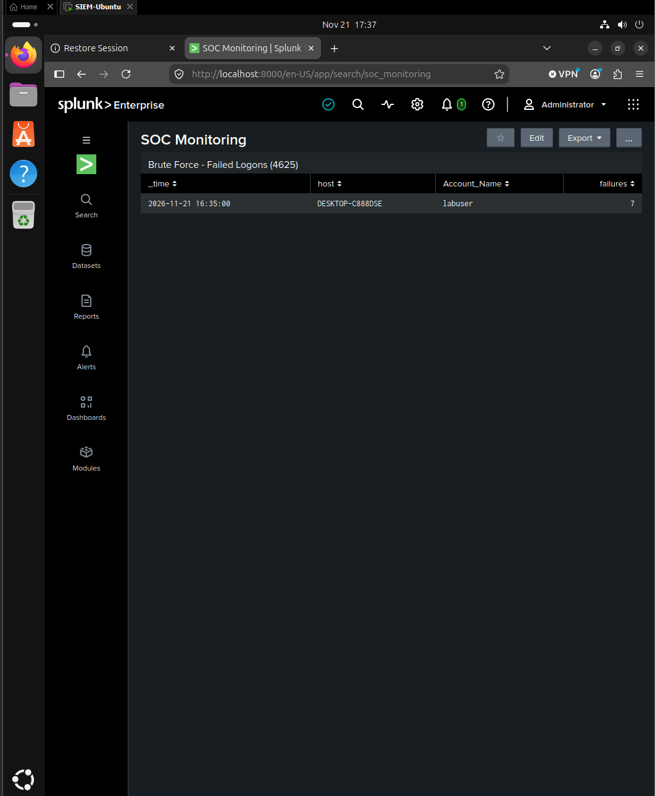
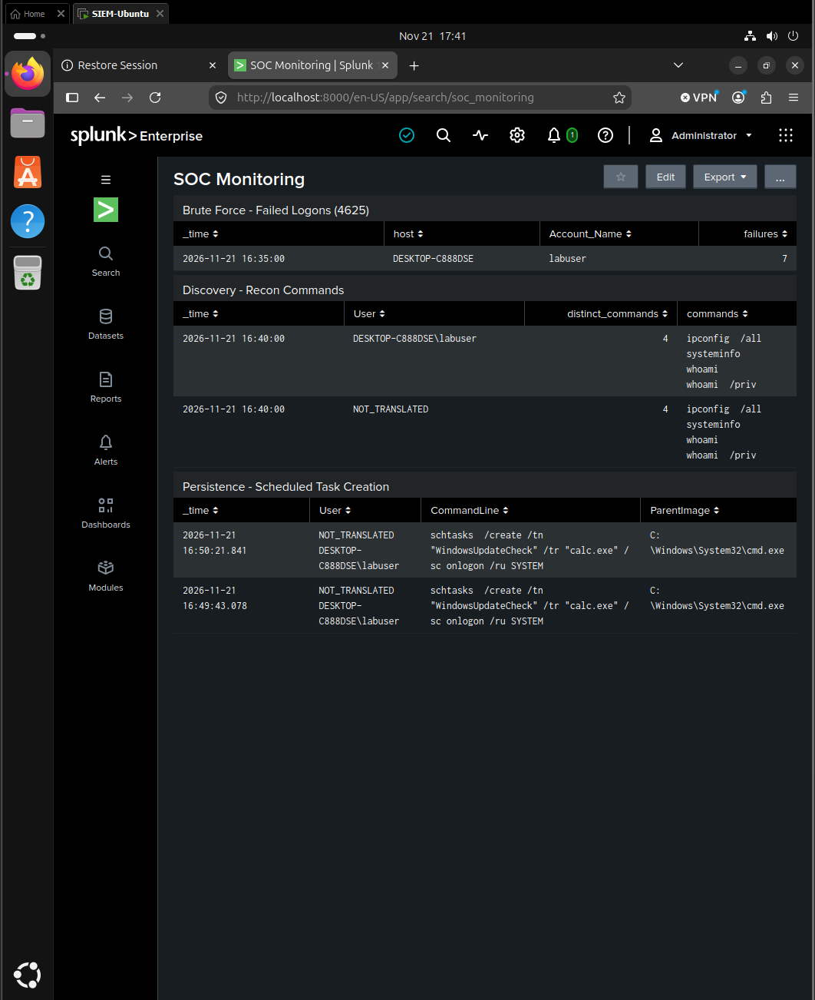

# Part 06: SOC Monitoring Dashboard

**Goal:** bring the three detections onto a single dashboard that refreshes on its own, the "single pane of glass" a Tier 1 analyst watches during a shift.

**What I ended up with:** a `SOC Monitoring` dashboard with one panel per detection, each mapped to a MITRE ATT&CK tactic.

---

## Building it

Each detection became a panel using **Save As → Dashboard Panel**: the first created the dashboard, the next two were added to the existing one.



### Panel 1: Brute Force — Failed Logons (4625)
```spl
index=wineventlog EventCode=4625
| bin _time span=5m
| stats count as failures by _time, host, Account_Name
| where failures >= 5 AND NOT like(Account_Name, "%$")
```
MITRE: T1110 Brute Force (Credential Access).

### Panel 2: Discovery — Recon Commands
```spl
index=sysmon EventCode=1 (CommandLine="*whoami*" OR CommandLine="*net user*" OR CommandLine="*net localgroup*" OR CommandLine="*net group*" OR CommandLine="*systeminfo*" OR CommandLine="*ipconfig*" OR CommandLine="*nltest*" OR CommandLine="*quser*")
| bin _time span=10m
| stats dc(CommandLine) as distinct_commands values(CommandLine) as commands by _time, User
| where distinct_commands >= 3
```
MITRE: Discovery (TA0007).

### Panel 3: Persistence — Scheduled Task Creation
```spl
index=sysmon EventCode=1 CommandLine="*schtasks*" CommandLine="*/create*"
| table _time, User, CommandLine, ParentImage
```
MITRE: T1053.005 Scheduled Task (Persistence).

---

## The finished dashboard



Three detections, three tactics, one screen that updates automatically.

---

## The full pipeline

```
Windows endpoint  →  Universal Forwarder  →  Splunk (indexer + search head)  →  detections  →  dashboard
   (Event Logs,         (ships over 9997)         (wineventlog, sysmon)         (saved        (SOC Monitoring)
    Sysmon)                                                                      searches)
```

This is the same flow a real SOC runs: endpoints generate telemetry, a forwarder ships it, a SIEM stores and searches it, detections turn it into alerts, and a dashboard puts it in front of an analyst.

## Possible next steps

- Convert the detections into scheduled **alerts** so they notify instead of needing a manual look
- Turn table panels into charts (a failed-logon trend line, a tactic breakdown)
- Restrict Splunk's Postgres port to localhost (open item from Part 04)
- Enable the "Other Object Access Events" audit policy so Event 4698 captures scheduled-task creation (from Part 05)
- Add more detections: credential dumping, lateral movement, defense evasion

## What the whole lab covered

| Part | Built |
|---|---|
| 01 | Splunk Enterprise on Ubuntu, running as a least-privilege service |
| 02 | Windows 11 victim; diagnosed a hypervisor conflict and migrated VirtualBox → VMware |
| 03 | Networked both VMs; traced and fixed a firewall-blocked connection |
| 04 | Sysmon + Universal Forwarder; fixed protected-log permissions |
| 05 | Simulated brute force, discovery, and persistence; built detections mapped to MITRE ATT&CK |
| 06 | SOC monitoring dashboard |
